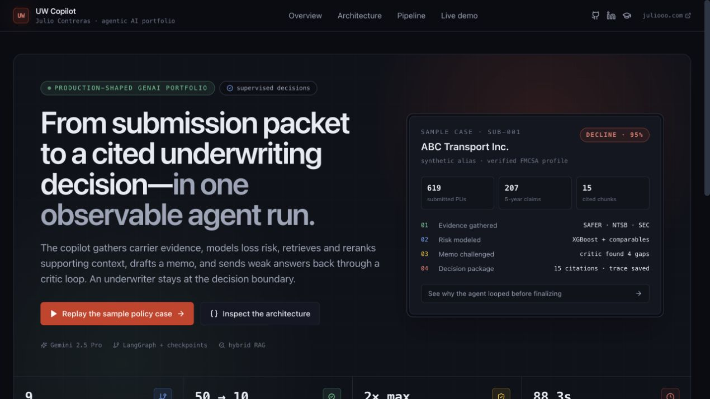
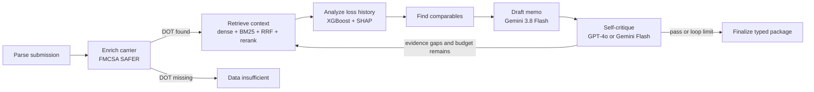
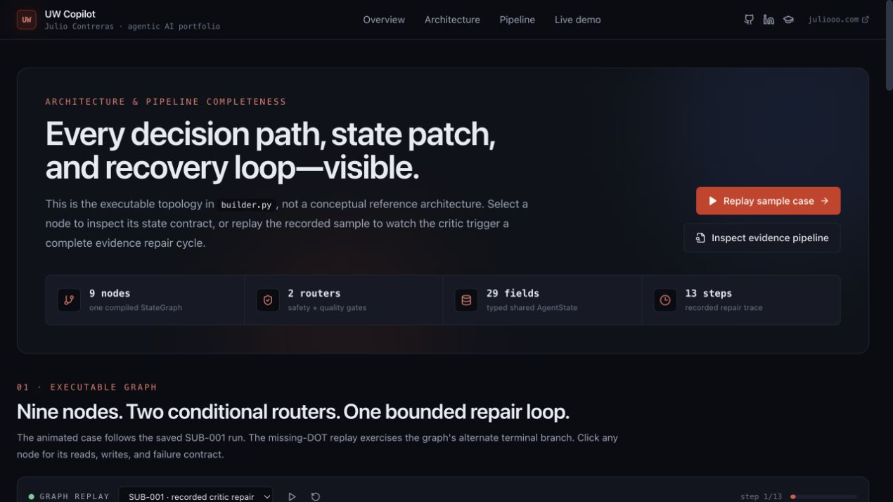
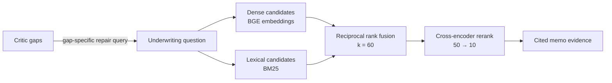

# Commercial Insurance Agentic Underwriting Copilot

An observable, evaluation-first commercial auto underwriting system. It turns a submission packet into a cited decision-support memo by combining a stateful LangGraph agent, hybrid retrieval, public carrier evidence, an XGBoost risk tool, and a bounded critique-and-repair loop.

**[Explore the live project](https://juliooo.com/agentic-underwriting)**

> This is decision support, not automated underwriting. The sample submissions and book-of-business records are synthetic; cited carrier and safety evidence comes from public sources.



## What the system demonstrates

| Capability | Implementation |
| --- | --- |
| Agent workflow | Nine typed LangGraph nodes, two conditional routers, a bounded repair loop, and durable SQLite checkpoints |
| Retrieval | Chroma dense search with `BAAI/bge-large-en-v1.5` + BM25 + reciprocal rank fusion (`k=60`) + cross-encoder reranking from 50 candidates to 10 |
| Generative AI | Gemini 3.8 Flash drafts through the Google Gemini API; Gemini 3.5 Flash Lite handles parsing and optional critique |
| Independent critique | GPT-4o critiques Gemini drafts when an OpenAI key is configured, reducing same-model judging bias |
| Classical ML | XGBoost loss-frequency prediction with isotonic calibration and SHAP feature attribution |
| Evidence and tools | FMCSA carrier enrichment, NTSB narratives, SEC 10-K risk factors, loss calculations, and comparable-account search |
| Evaluation | Retrieval, generation, and task-level tracks plus component ablations for RAG, critique, comparables, and XGBoost |
| Delivery | FastAPI/SSE backend on Cloud Run and a Next.js 15 interface on Vercel |

## Executable architecture

This is the graph compiled in `backend/app/graph/builder.py`. The alternate terminal path catches submissions without a usable DOT number; the critique router can reopen retrieval and regenerate the memo before finalization.





### Model authentication

The deployed Gemini calls use an API key stored in Google Secret Manager. Set `GEMINI_AUTH_MODE=api_key`, `GEMINI_API_BACKEND=developer`, and `GEMINI_API_KEY` for a Google AI Studio key. Vertex AI express keys are supported with `GEMINI_API_BACKEND=vertex`. API-key calls omit project/location and never fall back to ADC when a key is missing.

- `GEMINI_AUTH_MODE=adc` explicitly selects the Google Cloud credential/service-account path instead.
- `GEMINI_AUTH_MODE=auto` prefers a configured API key, otherwise uses ADC.
- Google API-key billing belongs to the project associated with that key.
- `OPENAI_API_KEY` is separate. It enables the cross-family GPT-4o critic and LLM-as-judge evaluation. In `auto` mode, an unavailable OpenAI judge triggers an announced Gemini 3.5 Flash Lite fallback. Explicit OpenAI/Gemini selections never substitute a different provider.
- Cloud Run keeps one warm instance and gates startup on `/ready` until retrieval warmup finishes. This incurs ongoing idle-instance charges.
- The saved sample run below predates the November 2026 model migration; its recorded timings and metrics are historical.

## Retrieval and evidence flow



Dense retrieval handles semantic similarity while BM25 preserves rare insurance and carrier terminology. Both rankings use one chunk-ID space, are fused, reranked, and carried into the memo as inspectable citations. If model weights or an index are unavailable, the interface displays a clearly labeled deterministic fallback rather than presenting synthetic retrieval as live output.

## Recorded sample run

The repository includes a captured end-to-end `SUB-001` trace. It is a reproducible replay of real pipeline output, not a claim that every browser session is invoking the backend.

| Recorded signal | Value |
| --- | ---: |
| Submitted fleet | 619 power units |
| Five-year loss run | 207 claims · $23.9M incurred |
| Verified FMCSA profile | 604 power units · 712 drivers · 41 crashes in 24 months |
| Retrieved evidence | 15 cited chunks |
| Risk model | 3.69 predicted next-year claims · 80% interval 1.6–6.2 |
| Critique | GPT-4o identified four gaps and reopened the evidence chain |
| Graph trace | 13 node transitions · two memo drafts |
| Final package | Decline · 95% confidence · 88.35 seconds |

The recorded outcome is illustrative decision support for a synthetic alias linked to a public carrier profile. It is not a real carrier decision.

## Versioned evidence evaluation

`backend/scripts/07_run_evals.py` runs the v2 source-evidence benchmark once,
reuses its outputs across metrics, and publishes linked LangSmith experiments.
The frozen set has 20 synthetic packets (14 development and six carrier-disjoint
holdout cases) plus 20 retrieval questions (18 answerable and two no-source checks).

References were checked against the source text and frozen account records by
the coding agent. **Underwriter validation is pending.** Assertions measure
factual evidence handling, not actuarially correct quote/decline decisions.

The dashboard reports passage recall/MRR/nDCG, semantic assertion coverage,
unsupported material claims, citation-ID validity, disposition JSON validity,
completed/expected cases, and paired single-shot baseline results. Individual
claims and grading reasons remain inspectable in LangSmith. Missing documents
are separate from defects in a memo. Unrun component ablations are labeled as such.

The retired July draft-label/keyword scores are not directly comparable with v2.
See [docs/evaluation.md](docs/evaluation.md) for definitions and limitations and
the [live dashboard](https://uwcopilothartford.vercel.app/hartford/pipeline#evaluation)
for the published measured run.

## Repository map

```text
backend/
  app/
    graph/          # LangGraph state, nodes, routers, and checkpoints
    llm/            # Vertex AI Gemini and OpenAI judge clients
    tools/          # SAFER, loss, XGBoost, and comparable-account tools
    eval/           # retrieval, generation, task-level, and ablation tracks
  data/             # tracked public/synthetic artifacts and frontend exports
  scripts/          # ingestion, indexing, training, evaluation, and capture

frontend/
  src/app/          # overview, architecture, pipeline, and live-demo routes
  src/components/   # trace, retrieval, evaluation, and model visualizations
  public/data/      # validated browser-safe pipeline exports
```

## Run locally

### Prerequisites

- Python 3.11+, [uv](https://docs.astral.sh/uv/), Node.js, and pnpm
- A funded Gemini API key, or a Google Cloud project with Vertex AI enabled for ADC mode
- Optional: an FMCSA web key for live carrier lookup
- Optional: an OpenAI key for the GPT-4o critic and generation evaluation

```bash
# Repository root
cp .env.example .env
# Fill GEMINI_API_KEY and optionally OPENAI_API_KEY in .env
# For ADC mode instead: set GEMINI_AUTH_MODE=adc and run gcloud auth application-default login

# Backend
cd backend
uv sync
uv run uvicorn app.main:app --reload --port 8080

# Frontend, in another terminal
cd frontend
cp .env.local.example .env.local
pnpm install
pnpm dev
```

Open [http://localhost:3000](http://localhost:3000). The frontend defaults to `http://127.0.0.1:8080` for the local API. To mirror the deployment subpath, set `NEXT_PUBLIC_BASE_PATH=/hartford` and open `/hartford`.

### Build or refresh the data artifacts

The full orchestrator validates public inputs, builds retrieval indexes, trains the classical model, evaluates the agent, exports visualization data, and captures a showcase run.

```bash
cd backend
./scripts/run_pipeline.sh          # full pipeline
./scripts/run_pipeline.sh --quick  # skips LLM-judge evals and UMAP
```

When the corpus, submissions, and model are already current, refresh from evaluation onward:

```bash
cd backend
uv run python scripts/07_run_evals.py
uv run python scripts/08_export_viz_data.py --skip-umap
uv run python scripts/09_capture_showcase.py --submission SUB-001
```

`pnpm dev` and `pnpm build` run the frontend data sync automatically. Run it directly with:

```bash
cd frontend
pnpm run data:sync
```

## Test

```bash
cd backend
uv run pytest

cd ../frontend
pnpm exec tsc --noEmit
pnpm build
```

## Deploy

Run the data pipeline before building the Cloud Run image so the validated index, cached evidence, synthesized submissions, and model artifacts are included.

```bash
# Repository root — backend
gcloud builds submit --config cloudbuild.yaml .

# Frontend
cd frontend
vercel --prod
```

See [DEPLOY.md](./DEPLOY.md) for environment variables, secret setup, signed proxy requests, and health checks.

See [docs/langsmith.md](./docs/langsmith.md) to connect graph, tool, Gemini and
OpenAI traces to a LangSmith workspace and verify a production run.

## Provenance and responsible use

- FMCSA SAFER profiles, NTSB accident narratives, NHTSA/FARS aggregates, and SEC filings are public-source evidence.
- Submission packets, carrier aliases, and book-of-business comparables are synthetic.
- Visualizations declare whether their data is live pipeline output, pending, or illustrative.
- The live demo keeps a human underwriter at the decision boundary.
- This portfolio system has not been validated for production insurance decisions.

Built by [Julio Contreras](https://juliooo.com).

## Submission package and underwriter briefing

The **Submission package** navigation tab opens `/package`. Its views show the account briefing and complete memo, the full broker packet and analysis evidence, and the exact submission schema plus a clearly labeled individual-claim format reference. The saved packet contains annual loss aggregates; it does not contain fabricated individual claim files or missing ACORD/MVR attachments. Completed live runs link to `/package?run=<run_id>` and load their exact checkpoint through an authenticated server proxy. The recorded SUB-001 sample remains available without making model calls.
